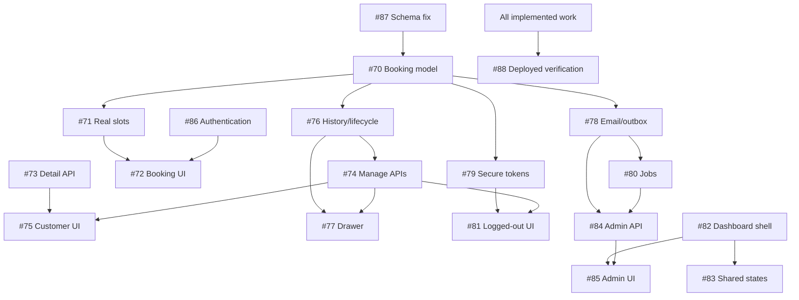

# Sprint 1 Plan — Trustworthy Booking and Management

## Project Goal

Make the appointment platform reliable, truthful, and complete for booking and post-booking management. The work must remove fake flows, reconcile the database, protect authentication, generate real available slots, support cancel/reschedule from customer and logged-out links, send booking emails and calendar files, show real admin data, and finish with a deployed bug bash and demo.

This plan covers the feedback issues **#66–#88**. Issues **R02 #61** and **R03 #62** are earlier rescheduling work and should be marked duplicate/superseded when their covered work is delivered through **#73–#75**.

## Working Stack

- Backend: Express, TypeScript, Prisma, PostgreSQL
- Frontend: React, TypeScript, Vite
- Deployment: Vercel
- Key backend folders: `backend/src/routes`, `backend/src/controllers`, `backend/src/services`, `backend/src/middleware`, `backend/prisma`
- Key frontend folders: `frontend/src/pages`, `frontend/src/components`, `frontend/src/layouts`, `frontend/src/routes`, `frontend/src/services`

## Issue Backlog

| Issue | Code | Area | Work |
|---|---|---|---|
| #66 | CARDS | Frontend | Remove card collection and fake payment flow |
| #67 | BASIC | Backend/Frontend | Give new businesses and providers the Basic package |
| #68 | DEBUG | Backend | Remove auth debug endpoint |
| #69 | LIMIT | Backend/DB | Rate-limit authentication requests |
| #70 | MODEL | Database | Add booking snapshots and management fields |
| #71 | SLOTS | Backend | Generate and reserve trustworthy slots |
| #72 | BOOKING | Frontend | Complete booking and saved confirmation |
| #73 | DETAIL | Backend | Customer details, paging, and profile |
| #74 | MANAGE | Backend | Atomically cancel and reschedule bookings |
| #75 | CUSTOMER | Frontend | Appointment details, cancel, and reschedule |
| #76 | HISTORY | Backend/DB | Shared lifecycle rules and appointment history |
| #77 | DRAWER | Frontend | Appointment actions and history drawer |
| #78 | MAIL | Backend/DB | Booking emails, calendar attachment, and outbox |
| #79 | TOKEN | Backend/DB | Secure logged-out management links |
| #80 | JOBS | Backend | Daily reminders and manual job trigger |
| #81 | MANAGEUI | Frontend | Logged-out manage booking page |
| #82 | SHELL | Frontend | One dashboard shell for all five roles |
| #83 | STATES | Frontend | Shared status components and truthful page states |
| #84 | ADMINAPI | Backend | Real admin overview and message records |
| #85 | ADMINUI | Frontend | Real admin overview, sent messages, and job controls |
| #86 | AUTH | Backend/Frontend | Preserve valid sign-in across refresh and booking |
| #87 | SCHEMAFIX | Database | Reconcile the experimental database model |
| #88 | VERIFY | Integration | Deployed bug bash and Friday demo |

## Dependencies

## Phased Implementation

### Phase 0 — Clean and unblock

Do these first:

1. **#66 CARDS**: remove all card/payment collection and fake payment UI.
2. **#67 BASIC**: assign Basic to every new business and provider.
3. **#68 DEBUG**: remove the auth debug endpoint.
4. **#69 LIMIT**: add authentication rate limits.
5. **#86 AUTH**: preserve login across refresh and booking redirects.
6. **#87 SCHEMAFIX**: reconcile Prisma, migrations, SQL, and the real database before schema additions.

Exit: signup/login works, no fake payment or debug route exists, schema changes are no longer drifting, and the team has a clean migration baseline.

### Phase 1 — Database model

Implement **#70 MODEL**, preferably while coordinating **#76 HISTORY** in the same migration:

- appointment booking snapshots
- management token hash and expiry fields
- cancellation/reschedule metadata
- appointment history/event table
- email outbox table
- required backfills and indexes

Exit: migration applies cleanly to a fresh database and to the existing database, with generated Prisma types committed.

### Phase 2 — Backend core

After Phase 1, split work across:

- **#71 SLOTS** — real availability and atomic reservation
- **#73 DETAIL** — appointment detail, paging, and profile APIs
- **#74 MANAGE** — atomic cancel and reschedule
- **#76 HISTORY** — lifecycle transitions and event history
- **#79 TOKEN** — secure logged-out management tokens
- **#78 MAIL** — outbox, booking/cancel/reschedule emails, `.ics` attachments
- **#80 JOBS** — reminder job and manual trigger
- **#84 ADMINAPI** — real overview and message records

Exit: APIs have tests and work independently of frontend mock data.

### Phase 3 — Frontend

Start **#82 SHELL** first, because other dashboard pages should share it.

Then implement:

- **#83 STATES** — loading, empty, error, and status components
- **#72 BOOKING** — complete saved booking flow and confirmation
- **#75 CUSTOMER** — appointment management journey
- **#77 DRAWER** — shared actions/history drawer
- **#81 MANAGEUI** — logged-out management page
- **#85 ADMINUI** — real overview and messages

Exit: no placeholder booking/admin data, refresh and navigation preserve state, slot conflicts are handled, and every role uses the dashboard shell.

### Phase 4 — Integration and release

Complete **#88 VERIFY**:

- deploy the integrated branch
- run the bug bash as all roles
- test email and calendar delivery
- test cancel, reschedule, refresh, and invalid tokens
- test rate limits and admin job controls
- fix blockers and prepare a Friday demo

## Proposed Sprint Sequence

| Block | Issues | Result |
|---|---|---|
| 1–2 | #66, #67, #68, #69, #86, #87 | safe baseline |
| 3 | #70, #71 | database and slot core |
| 4 | #73, #74, #76, #79 | protected lifecycle and secure management |
| 5 | #78, #80, #84 | mail, jobs, and admin API |
| 6 | #82, #83, #72, #75, #77 | dashboard, booking, and customer management |
| 7 | #81, #85 | public management and admin UI |
| 8 | #88 | deployment verification and demo |

## Branch Conventions

Use one issue per branch:

- `fix/66-remove-card-flow`
- `fix/68-auth-debug-endpoint`
- `feat/71-trustworthy-slots`
- `feat/78-booking-outbox`
- `feat/82-dashboard-shell`

Create from the latest integration branch or `main`.

## Pull Request Rules

- Keep one issue per PR.
- Reference `Closes #<issue-number>` in the PR description.
- Include database migrations for migration PRs.
- Add tests for backend logic and frontend loading/error behavior.
- Do not expose real secrets or `.env` values.
- Verify lint, tests, build, and the deployed environment before merge.

## Definition of Done

An issue is complete only when:

- every acceptance criterion is met
- the implementation has no fake or placeholder data
- loading, empty, and error states are truthful
- database changes are migrated and documented in the schema
- tests cover the main behavior and failure cases
- the PR builds locally and in deployment
- the issue is linked from the PR and can be closed cleanly
